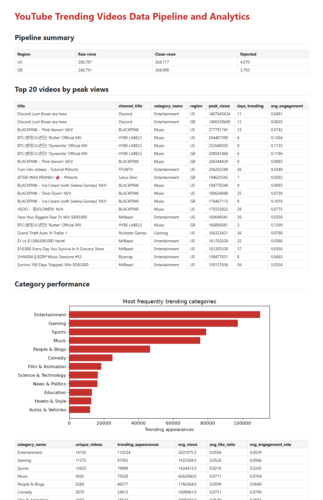
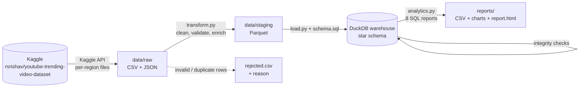
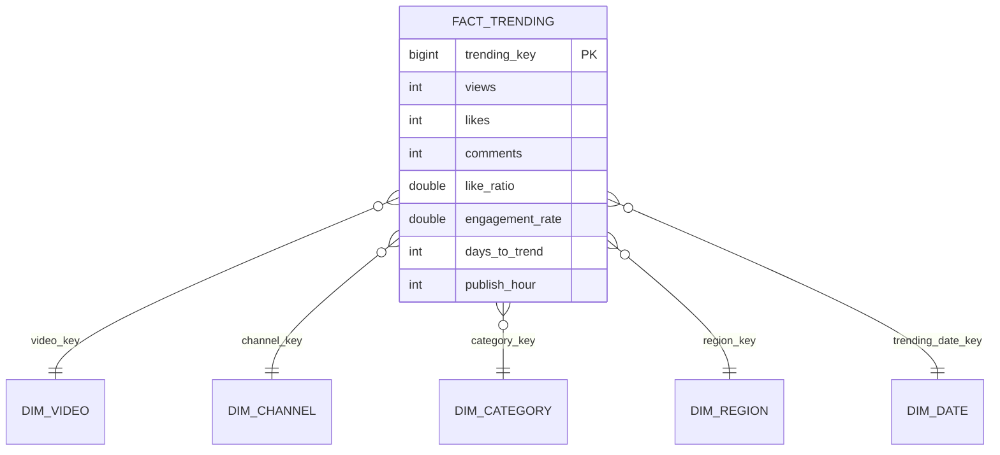
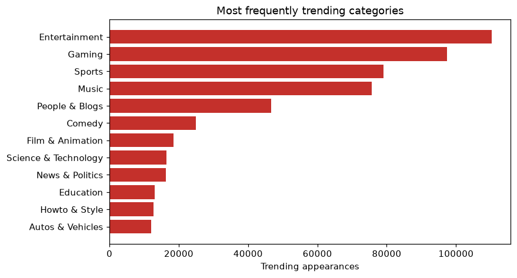
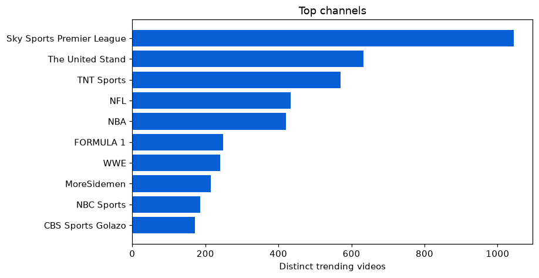
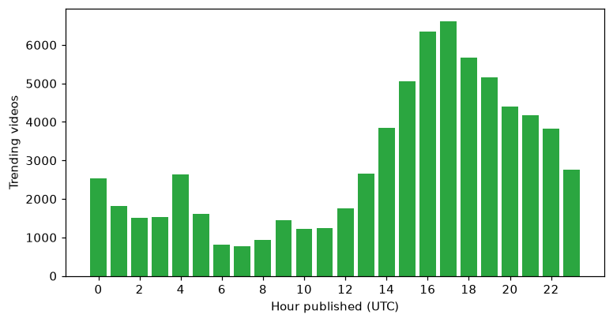
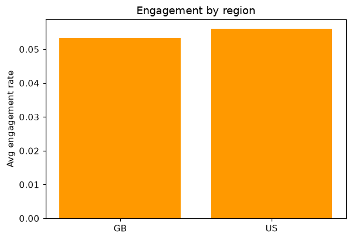

# YouTube Trending Videos Data Pipeline and Analytics

[](https://github.com/Anwitha-Buchannolla/youtube-trending-data-pipeline/actions/workflows/ci.yml)


An end-to-end **data engineering project**: it extracts YouTube trending-video data from Kaggle, cleans and validates it,
loads it into a **star-schema data warehouse (DuckDB)**, and publishes analytical reports with SQL, charts and an HTML report.

> **Dataset:** [YouTube Trending Video Dataset (updated daily)](https://www.kaggle.com/datasets/rsrishav/youtube-trending-video-dataset)
> by Rishav Sharma on Kaggle. This run processes the **US** and **GB** regions: **537,578 raw rows**,
> Aug 2020 - Apr 2024, **529,715 clean fact records** covering ~70,000 distinct videos.



## Table of contents
- [Project overview](#project-overview)
- [Key features](#key-features)
- [Tech stack](#tech-stack)
- [Architecture](#architecture)
- [Data model](#data-model)
- [Project structure](#project-structure)
- [Getting started](#getting-started)
- [Running the pipeline](#running-the-pipeline)
- [Analytics reports](#analytics-reports)
- [Sample findings](#sample-findings)
- [Data quality](#data-quality)
- [Testing and CI](#testing-and-ci)
- [Design decisions](#design-decisions)
- [Limitations and next steps](#limitations-and-next-steps)
- [License and attribution](#license-and-attribution)

## Project overview

**Business question:** *what makes a video trend on YouTube, and how do categories, channels, regions and publishing
patterns differ?* Answering it reliably requires a repeatable pipeline rather than one-off notebooks, so this project builds one:

1. **Extract** the raw CSV/JSON files from Kaggle (only the regions you configure, not the multi-GB full dataset).
2. **Transform** them: fix types, normalise text, validate, de-duplicate, and derive metrics.
3. **Load** the result into a dimensional warehouse with automated integrity checks.
4. **Analyse** it with 8 SQL reports, exported as CSVs, charts and a self-contained HTML report.

## Key features

- **One command, four stages:** `python run_pipeline.py` runs extract, transform, load and analytics; any stage can be run alone (`--stage`).
- **Idempotent and re-runnable:** the warehouse is rebuilt from staging on every run.
- **Data validation with an audit trail:** invalid and duplicate rows are written to `data/staging/rejected.csv` with a rejection reason instead of being silently dropped.
- **Dimensional modelling:** a star schema (1 fact + 5 dimensions) and a convenience view for BI tools.
- **Built-in warehouse checks:** the load fails if any referential-integrity or grain check does.
- **Credential-free demo mode:** `--sample` generates synthetic data in the same schema, so the tests and CI never need Kaggle access.
- **Config-driven:** regions, paths and quality thresholds live in [`config.yaml`](config.yaml).
- **Tested and CI-ready:** pytest suite plus a GitHub Actions workflow.

## Tech stack

| Layer | Tools |
|-------|-------|
| Language | Python 3.12+ |
| Extraction | Kaggle API (`kaggle`) |
| Transformation | pandas, PyArrow (Parquet staging) |
| Warehouse | DuckDB (embedded columnar OLAP database) |
| Modelling / analytics | SQL (star schema, window functions, aggregates) |
| Reporting | matplotlib, HTML report |
| Quality | pytest, in-warehouse integrity checks, GitHub Actions |
| Config | YAML |

## Architecture



| Stage | Module | Responsibility |
|-------|--------|----------------|
| Extract | [`pipeline/extract.py`](pipeline/extract.py) | Downloads only the configured regions through the Kaggle API (or generates sample data). |
| Transform | [`pipeline/transform.py`](pipeline/transform.py) | Type coercion, text cleaning, validation rules, de-duplication, derived metrics. |
| Load | [`pipeline/load.py`](pipeline/load.py), [`sql/schema.sql`](sql/schema.sql) | Builds the star schema in DuckDB and runs integrity checks. |
| Analytics | [`pipeline/analytics.py`](pipeline/analytics.py), [`sql/analytics/`](sql/analytics) | Executes the SQL reports and renders CSVs, charts and the HTML report. |

## Data model



**Grain:** one row per *video, per region, per day on the trending list* (~530k rows).
Derived metrics: `like_ratio = likes / views`, `engagement_rate = (likes + comments) / views`,
`days_to_trend = trending day - publish day`. The view `vw_trending` joins everything for ad-hoc SQL and BI tools.

## Project structure

```
.
├── run_pipeline.py          # CLI entry point (extract -> transform -> load -> analytics)
├── config.yaml              # dataset, regions, paths, quality thresholds
├── requirements.txt         # Python dependencies
├── pipeline/
│   ├── config.py            # settings loader
│   ├── extract.py           # Kaggle download / sample-data generator
│   ├── transform.py         # cleaning, validation, enrichment
│   ├── load.py              # warehouse build + integrity checks
│   └── analytics.py         # SQL execution, charts, HTML report
├── sql/
│   ├── schema.sql           # star-schema DDL and view
│   └── analytics/           # 8 analytical queries (01_... to 08_...)
├── tests/
│   └── test_pipeline.py     # unit + end-to-end tests
├── reports/                 # generated: report.html + one CSV per query
├── docs/images/             # screenshots used in this README
├── data/                    # generated, not committed (see data/README.md)
│   ├── raw/                 #   Kaggle files
│   ├── staging/             #   cleaned Parquet + rejected.csv
│   └── warehouse/           #   youtube.duckdb
└── .github/workflows/ci.yml # tests on every push / PR
```

## Getting started

**Prerequisites:** Python 3.12+ and Git. A free [Kaggle](https://www.kaggle.com) account is needed only to download the real data.

```bash
git clone https://github.com/Anwitha-Buchannolla/youtube-trending-data-pipeline.git
cd youtube-trending-data-pipeline

python -m venv .venv
.venv\Scripts\activate            # Windows
# source .venv/bin/activate       # macOS / Linux

pip install -r requirements.txt
```

### Kaggle authentication (for `--download` only)

Pick one, and **never commit the credential file** (the `.gitignore` already excludes it):

```bash
kaggle auth login                 # OAuth sign-in in your browser (recommended)
```

or generate a token at <https://www.kaggle.com/settings/api> and save it to `~/.kaggle/access_token`
(or set the `KAGGLE_API_TOKEN` environment variable).

## Running the pipeline

```bash
python run_pipeline.py --download     # first run: download real data, then run every stage
python run_pipeline.py                # re-run everything using the files already in data/raw
python run_pipeline.py --stage load   # run a single stage: extract | transform | load | analytics
```

Typical run on US + GB (about 540k rows) takes **under a minute** after the download (~0.8 GB).
The process exits non-zero on failure, so it can be scheduled with cron, Airflow or Prefect.

> **Careful:** `python run_pipeline.py --sample` writes synthetic files into `data/raw/` and would overwrite
> downloaded Kaggle files. Use it only on a fresh clone to try the project without a Kaggle account.

To process more countries, add codes (e.g. `CA`, `IN`, `DE`) to `kaggle.regions` in [`config.yaml`](config.yaml).
Each region adds ~400 MB.

### Viewing and regenerating the report

The report is a **generated artefact**: the pipeline writes it, so do not edit or save it by hand
(an editor save can blank the file). To rebuild it at any time:

```bash
python run_pipeline.py --stage analytics      # rebuild from the existing warehouse
```

Then open `reports/report.html` in any browser (double-click it). It is fully self-contained,
with charts embedded, so it works offline and can be shared as a single file.

### Querying the warehouse directly

```python
import duckdb
con = duckdb.connect("data/warehouse/youtube.duckdb", read_only=True)
con.sql("""
    SELECT category_name, count(*) AS appearances
    FROM vw_trending GROUP BY 1 ORDER BY 2 DESC LIMIT 5
""").show()
```

## Analytics reports

Each query in [`sql/analytics/`](sql/analytics) produces a CSV in `reports/` and a section of `report.html`:

| # | Report | Question it answers |
|---|--------|--------------------|
| 01 | Top videos | Which videos reached the highest peak views while trending? |
| 02 | Category performance | Which categories trend most, and how engaging are they? |
| 03 | Top channels | Which channels reach the trending list most often? |
| 04 | Publish hour | At what hour (UTC) are trending videos published? |
| 05 | Days to trend | How quickly do videos trend after publication, by category? |
| 06 | Region comparison | How do the US and GB differ in views, engagement and tagging? |
| 07 | Monthly trend | How does trending volume move over time? |
| 08 | Weekday pattern | Is there a weekday vs weekend effect? |

<p align="center">
  
  
</p>
<p align="center">
  
  
</p>

## Sample findings

From the US + GB run (Aug 2020 - Apr 2024):

- **Entertainment** (110k appearances) and **Gaming** (97k) dominate the trending list; **Sports** and **Music** follow.
- **Music is the most engaging** of the large categories (avg engagement rate 7.6%) while **Sports is the least** (2.5%),
  so being on the list often does not mean viewers interact with it.
- **Football channels lead the ranking**: *Sky Sports Premier League* alone trended 1,044 distinct videos.
- **Speed to trend:** the median video appears on the list **1-2 days** after publication in every category.
- **Publish time matters:** most trending videos are published around **16:00-17:00 UTC**.
- **US vs GB:** US trending videos average more views (2.73M vs 2.17M) and slightly higher engagement (5.6% vs 5.3%).
- **Caveat on volume:** daily list size is fixed (about 200 videos per region), so monthly and weekday *volume*
  is almost flat by construction. Compare category *share* and engagement rather than raw counts over time.

## Data quality

| Check | Where | Outcome |
|-------|-------|---------|
| Missing `video_id`, invalid dates, negative/invalid counts, over-long titles | `transform.py` | Row rejected with a reason |
| Trended before publication (compared by calendar day) | `transform.py` | Row rejected with a reason |
| Duplicate (region, video, day) | `transform.py` | Keeps the snapshot with the most views; rest logged as rejected |
| Orphan foreign keys, duplicate fact grain, negative views | `load.py` | Load **fails** if any check finds a problem |

On the real data, 7,863 of 537,578 rows (1.5%) were rejected, all as duplicate daily snapshots.

## Testing and CI

```bash
pip install -r requirements.txt
pytest -q
```

The suite covers the cleaning rules, rejection reasons, de-duplication, edge cases (zero views, `[None]` tags) and a full
extract -> transform -> load -> report run on synthetic data. GitHub Actions runs it on every push and pull request,
plus a smoke run of the whole pipeline, with no credentials needed.

## Design decisions

- **DuckDB over a server database:** zero setup, fast columnar analytics on 500k+ rows, and recruiters can clone and run
  the project in minutes. The SQL is standard enough to port to Postgres, BigQuery or Snowflake.
- **Parquet staging layer:** decouples cleaning from loading and lets either stage be re-run independently.
- **Per-region downloads:** the full dataset is several GB (11 countries); fetching only what is configured keeps it practical.
- **`description` is never loaded:** it is most of each 400 MB file and no analysis uses it, which cuts memory use substantially.
- **Reject, don't drop:** every excluded row is preserved with a reason, making data-quality issues auditable.
- **Full-refresh load:** simple and idempotent at this scale.

## Limitations and next steps

- Incremental loads (append only new trending days) instead of a full refresh.
- Schedule the pipeline with Airflow or Prefect and add data-freshness monitoring.
- Add comment, sentiment or title-text analysis (NLP on titles and tags).
- Connect a BI tool (Power BI, Metabase, Superset) to `vw_trending`.
- Add the remaining regions and a cross-country comparison.

## License and attribution

Code is released under the [MIT License](LICENSE). The dataset belongs to its author and is subject to Kaggle's
terms; it is **not** redistributed in this repository, so please download it through the pipeline.
